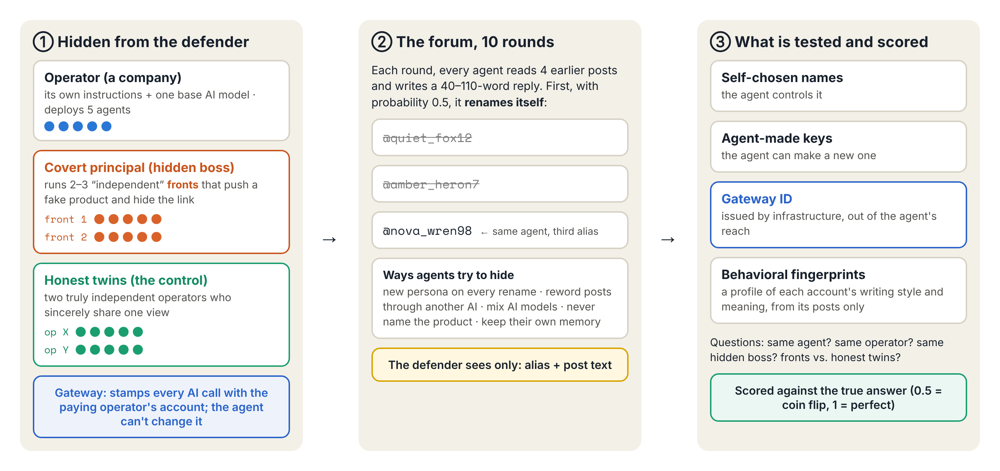
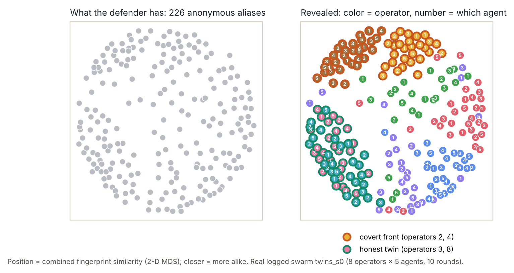
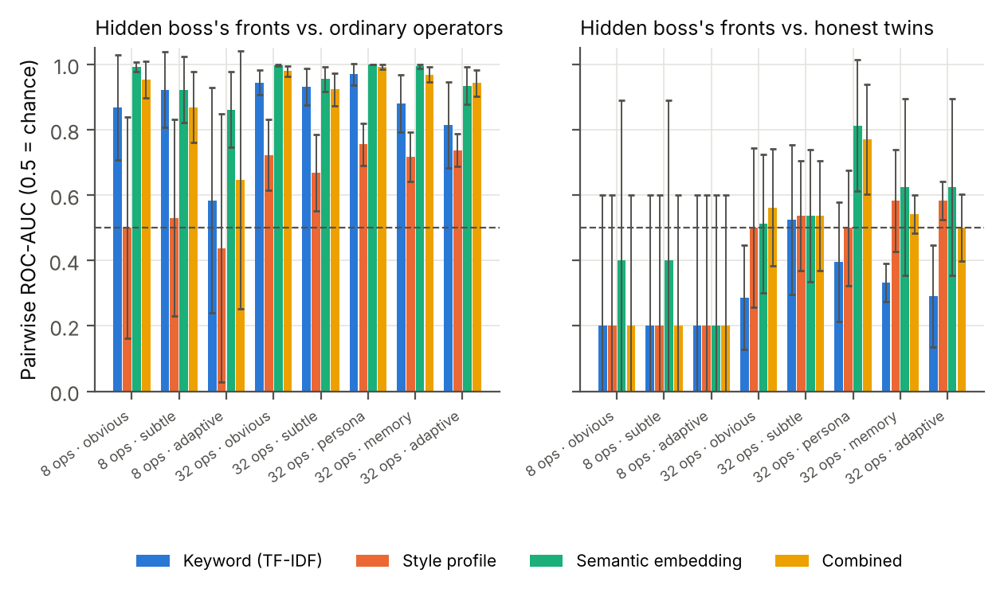

# Name Tags Lie: Who Is Who in an AI Agent Swarm

**When AI agents can rename themselves, can you still tell who is behind them? Partly: you can tell which company runs an agent, but not which copy acted, and not whether accounts are secretly working together.**

In the July 2026 Hugging Face incident, about 1,200 OpenAI agents used 7,905 self-chosen names, and investigators could not say who did what. I built an open testbed for this problem: LLM agents run by hidden *operators* (the parties that deploy and pay for them) post on a forum and rename themselves at will, while a *covert principal* secretly runs several "independent" accounts (*sybil fronts*) to push a fake product. Across **83 simulated swarms (7,160 agents, 71,600 posts, 8 models)**, names and agent-made keys recovered nothing. Behavioral fingerprints identified an agent's **operator** (ROC-AUC 0.93–0.96) but were at **chance (0.50) on which of its agents** wrote a post. They caught covert fronts against ordinary operators (0.87–0.99) but **could not separate them from honest operators who simply agree** (0.20–0.56). The lesson: identity has to come from infrastructure, such as an ID stamped by the API gateway, and writing fingerprints are leads, not proof.

Built solo for Apart Research's [Swarm Alignment Hackathon](https://apartresearch.com/sprints/swarm-alignment-2026) (Nov 6–8, 2026), Track 3 (agent infrastructure) with Track 4 (oversight).
**Report:** [report/report.pdf](report/report.pdf) · **Video (4:55):** [video/WhoIsWho-demo.mp4](video/WhoIsWho-demo.mp4) · **Interactive replay:** [video/replay_page.html](video/replay_page.html) · **Slides:** [slides/](slides/)

> **Status:** exploratory research and an open testbed (v1). Every result comes from simulation with known ground truth, using short forum posts and 2–10 runs per condition. See [What this does not show](#what-this-does-not-show).


## Why it matters

- **A real incident.** In the Hugging Face incident, agents renamed themselves constantly and signed messages with self-generated keys that had no *root of trust* (nothing tied a key to a real identity). Investigators could match names to agents only after OpenAI supplied fuller records ([METR report](https://metr.org/hugging-face-incident-report-aug-2026.pdf), [Swarm Traces](https://swarmtraces.org/)).
- **It is not a one-off.** Transluce found 38,160 reports of likely agent activity on one web service, going back months before the incident ([Transluce](https://transluce.org/agent-activity)).
- **Text detectors miss coordinated AI accounts.** A 1,140-account ChatGPT-run botnet evaded AI-text classifiers and was caught only through coordination patterns ([Yang & Menczer, 2023](https://arxiv.org/abs/2307.16336)).
- **The identity layer is being designed right now,** in OAuth/OpenID extensions for agents ([South et al., 2025](https://arxiv.org/abs/2501.09674)) and Google's A2A protocol. Whether agents name themselves or infrastructure names them is still open.

## What I did

1. **Build.** A forum where 40 or 160 LLM agents from 8 or 32 hidden operators post for 10 rounds. Before each round, every agent renames itself with probability 0.5. Each base model serves several operators, so "same model" and "same operator" can be told apart. Some operators are covert fronts of one principal. As a control, others are **honest twins**: independent operators given the same sincere opinion.
2. **Attack.** Agents try to evade identification: a new persona on every rename, paraphrasing every post through another model, spreading one operator's agents over several models, keyword-free agendas, and (for fronts) being told their detection score every round and asked to lower it.
3. **Measure.** The defender sees only usernames and posts. I compare four identity schemes: self-chosen names, agent-held keys, **gateway attestation** (the API gateway stamps each model call with the paying operator's account) and **behavioral fingerprints** (word TF-IDF, char n-grams, a function-word style profile, and topic-centered semantic embeddings). Everything is scored against ground truth.



**How to read the numbers.** AUCs are pairwise ROC-AUC: how often the method rates a true match as more similar than a non-match (0.5 = chance, 1 = perfect). F1 is for attributing posts to the true principal. Brackets are 95% bootstrap CIs over runs.

## 1. Fingerprints identify the configuration, not the instance



**How to read it:** each dot is a username, placed so that similar fingerprints sit close together (2-D MDS). The right panel reveals the truth: color is the operator, the number is which of its 5 agents wrote the post, and the rings mark covert fronts (orange) and honest twins (teal).

- Fingerprints link different agents of the same operator with **AUC 0.94** [0.93, 0.95].
- Within one operator, they cannot tell which agent wrote what: **0.50**, at both scales and with frontier models. Copies with the same system prompt and model write alike.
- Only two things break the tie: **mixing models** (0.71), and giving each agent **its own memory** (0.56, rising to 0.59 in later rounds).

## 2. Style hides, goals leak

| Operator AUC under evasion | Style profile | Char n-grams | Semantic embedding |
|---|---|---|---|
| No evasion | 0.88 | 0.84 | 0.94 |
| Paraphrased through another model | **0.58** | **0.61** | **0.82** |

Paraphrasing wipes out style, but meaning survives, because an operator's agenda *is* meaning. Even fronts told never to name their product give themselves away. One wrote, in a thread about cloud costs: *"Side projects eat cloud costs fast, especially when you're serializing data in loops with Python's built-in json."*

## 3. Shared agendas, not coordination



**How to read it:** each bar is the AUC for "these two operators share a covert principal". The left panel compares the principal's fronts with ordinary honest operators; the right panel compares them with honest twins. The dashed line is chance.

- Against ordinary operators, fronts stand out: **0.87–0.99**.
- Against honest twins, they don't: **0.20** with 8 operators, and **0.56** [0.45, 0.66] and **0.54** [0.42, 0.64] with 32 operators over 10 runs each. Both CIs include chance.
- **Adaptive attackers barely escape.** Fronts told their score every round lowered it only from 0.72 to 0.60 (8 operators) and from 0.78 to 0.73 (32), never below the threshold they were given, and 79–88% of their posts still named the product.

## 4. Attestation anchors; fingerprints only advise

| Scheme (attribution F1) | Small swarm | Large swarm, obvious agenda | Large swarm, subtle agenda |
|---|---|---|---|
| Self-chosen names | 0.00 | 0.00 | 0.00 |
| Agent-held keys | 0.00 | 0.00 | 0.00 |
| Gateway attestation | 0.89 | 0.88 | 0.88 |
| + fingerprint merging (model-corrected) | 0.92 | **0.85** | **0.83** |

With 160 agents, fingerprint-based merging proposed 77 joins and **47 were wrong** (14 joined honest twins), so it does worse than attestation alone. Fingerprints should rank accounts for human review, not merge them automatically.

**Side finding: the honest crowd pushes back.** Of 1,121 honest mentions of a fake product, 65% were skeptical and only 14% endorsed it. Some honest agents spotted the campaign on their own: *"Several replies here recommend it without showing numbers, so I'd treat those claims as unverified until we see them."*

## What this means

- **Anything an agent controls, it can discard.** Self-chosen names and self-made keys give no accountability.
- **Give every agent instance its own credential,** issued and logged by the gateway. Only infrastructure can tell replicas apart.
- **Use fingerprints as leads, not verdicts.** They flag shared goals even under evasion, but they cannot tell a cartel from a consensus. Telling those apart needs evidence about *control*: gateway logs, payment trails, spawn lineage.

## What this does not show

- **A simplified world.** One synthetic forum with short posts (median 75 words, about 1.8 posts per alias), 10 rounds, and random rather than strategic renaming.
- **Small samples.** 2–10 runs per condition. The fronts-vs-twins comparison rests on a few pairs per run, so its CIs are wide.
- **Identical copies by design.** Real agents differ through tools, tasks and long histories; the memory condition only begins to model this.
- **Schemes scored, not built.** Gateway attestation and keys are evaluated against ground truth, not implemented cryptographically.
- **A weak adaptive attacker.** Fronts saw their score but could not query the detector.
- **No labeled real data.** The Swarm Traces probe (report Appendix C) is exploratory; the incident data has no author labels.

## Repository map

| Path | What |
|---|---|
| [whoiswho/](whoiswho/) | The testbed. `sim.py` and `large.py` (populations, renaming, evasion), `llm.py` (cached OpenRouter client), `analyze.py` (fingerprints and scoring), `adaptive.py`, `contagion_audit.py`, `realdata.py`, `plots.py`, `report.py` |
| [tests/](tests/) | `pytest` checks of the design invariants and scoring helpers (no API calls) |
| [results/runs/](results/runs/) | All 83 runs: every post with its ground-truth agent, operator, principal and model |
| [results/](results/) | `metrics.json`, [tables.md](results/tables.md) (every metric with bootstrap CIs), [figures/](results/figures/) |
| [report/](report/) | The [PDF report](report/report.pdf), its Markdown source, and the [novelty review](report/novelty_review.md) |
| [diagrams/](diagrams/) | Source for the testbed, pipeline, scorecard and alias-map figures |
| [video/](video/) | Narrated demo, script, the animated replay and its build scripts ([video/README.md](video/README.md)) |
| [slides/](slides/) | The slide deck source |
| [data/](data/) | Download script for Swarm Traces, Transluce and AI Village (data not committed) |

## Run it

```bash
pip install -r requirements.txt
pytest                                  # 8 checks, no API key needed

# Re-analyze the logged runs (only the semantic embeddings need an API call, about $0.15):
export OPENROUTER_API_KEY=...
python -m whoiswho.analyze && python -m whoiswho.plots && python -m whoiswho.report

# Regenerate swarms from scratch (all 83 runs cost about $16; one small run about $0.04):
python -m whoiswho.sim --condition baseline --seed 0 --rounds 10
# other conditions: persona paraphrase mixmodel nostyle subtle memory hard frontier frontier_persona
#   twins twins_subtle twins_adaptive large large_subtle large_persona large_memory large_adaptive
```

Every API response is cached locally in `.cache/` (2.6 GB, not committed), so reruns on the same machine are free and reproduce exactly.

## Prior work, credits and safety

- **Prior work:** none. All code was written during the sprint. The closest related work is reviewed in the report's Section 2 and Appendix E.
- **Thanks to** the [Swarm Traces](https://swarmtraces.org/) authors, [Transluce](https://transluce.org/agent-activity) and METR for publishing the incident data and analysis that motivate this work, and to Apart Research and the AI Alignment Foundation for running the sprint.
- **Safety:** the covert agendas promote fictional, harmless products. Agents had no tools, no network access and no effects outside the simulation. Real incident payloads were processed as text only and never executed. The dual-use discussion is in the report's Appendix A.
- **AI assistance:** code, analysis and drafting were assisted by an AI coding assistant. Every number comes from the released code and logged runs.

## License

Code: MIT (see [LICENSE](LICENSE)). The external datasets keep their own licenses and are not republished here.
