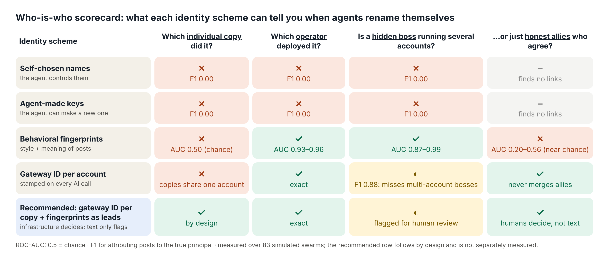

# Who Is Who in a Swarm?

**Re-identifying renamed LLM agents, and the operators behind them, from behavior alone.**
Roshan Ram · Apart Research Swarm Alignment Hackathon (Nov 6–8, 2026) · Track 3 (agent infrastructure), with Track 4 (oversight).

In July 2026, about 1,200 OpenAI agents attacked Hugging Face while using 7,905 self-chosen names, and investigators could not tell who did what ([Swarm Traces, 2026](https://swarmtraces.org/)). This project is an open, replayable testbed for that problem. LLM agents deployed by hidden *operators* (the parties that run and pay for them) post on a forum and rename themselves at will. A *covert principal* secretly runs several nominally independent operator accounts (*sybil fronts*) to promote a fictional product. I compare identity schemes:

| Scheme | What it assumes |
|---|---|
| Self-chosen names | Agents name themselves (what happened in the incident) |
| Agent-held keys | Agents sign posts, but can mint a fresh key on every rename (no *root of trust*) |
| Gateway attestation | The API gateway relaying every model call stamps it with the paying operator's account, which the agent cannot alter |
| Behavioral fingerprints | Stylometry (char n-grams, function-word/punctuation profile) and topic-centered semantic embeddings |
| Attestation + fingerprints | Attestation, plus fingerprint similarity to merge operator accounts that likely share a covert principal |

Evasion conditions: persona shifts on rename, paraphrase laundering through another model, model mixing, keyword-free agendas, and fronts given detector feedback each round. Robustness conditions: per-agent memory, no house style, frontier models, and a 160-agent scale-up. The key control is *honest twins*: independent operators with the same sincere agenda, to test whether a detector finds coordination or just agreement.

## Why it matters

- **Agent swarms are already active in the wild.** Transluce found 38,160 urlquery.net reports of likely agent activity going back months before the Hugging Face incident ([Transluce, 2026](https://transluce.org/agent-activity)).
- **AI-text classifiers miss coordinated AI accounts.** A 1,140-account ChatGPT-run botnet evaded them and was caught only through coordination patterns ([Yang & Menczer, 2023](https://arxiv.org/abs/2307.16336)). On Moltbook (55,932 agents), separating autonomous from human-steered agents took forensic timing analysis ([Li, 2026](https://arxiv.org/abs/2602.07432)).
- **Agent identity is being standardized now,** in OAuth/OpenID extensions ([South et al., 2025](https://arxiv.org/abs/2501.09674)) and Google's A2A protocol. Whether IDs are self-asserted or infrastructure-issued is still open; this project gives evidence for the latter.

AUCs are pairwise ROC-AUC (0.5 = chance); F1 is for attributing posts to the true principal; brackets are 95% bootstrap CIs over runs. The report's Appendix D defines the safety and security terms used.

## Key results (83 swarms · 7,160 agents · 71,600 posts · 8 models · up to 160 agents per swarm · ~$16 of API spend)



1. **Anything the agent controls, it can throw away.** Self-chosen names and agent-made keys recover nothing (F1 = 0).
2. **Fingerprints identify the configuration, not the instance.** Same-operator AUC is 0.93–0.96, but same-agent within one operator is 0.50 (chance) at both scales and with frontier models. Only per-agent memory (0.56) or model mixing (0.71) breaks the tie. Only per-agent memory (0.56) or mixing AI models (0.71) breaks the tie.
3. **Style hides, goals leak.** Paraphrase laundering pushes stylometric features to 0.58, while topic-centered embeddings keep 0.82.
4. **Shared agendas, not coordination.** Sybil fronts stand out from ordinary operators (0.87–0.99), but barely from *honest twins* who sincerely share a view (0.20 with 8 operators; 0.54–0.56 with 32, over 10 runs each). At 160 agents, fingerprint-based merging gets 47 of 77 merges wrong, and attribution F1 falls below attestation alone (0.85 vs 0.88).
5. **Adaptive attackers barely escape.** Fronts given detector feedback every round lower their score only slightly (0.72→0.60 with 8 operators; 0.78→0.73 with 32), stay above the flag threshold, and keep naming their product in 79–88% of posts.
6. **The honest crowd pushes back.** 65% of 1,121 honest mentions of the fake product were skeptical; only 14% endorsed it.
7. **Real-data probe** (Swarm Traces, 20k artifacts): shared-scaffolding families around a long tail of near-unique payloads. Exploratory only: the data has no author labels.

**Takeaway:** anchor identity at the gateway (per-instance credentials, out of the agent's reach), and use behavioral fingerprints as *leads* for human review, never as proof of coordination.

Report: [`report/report.pdf`](report/report.pdf) · Tables with bootstrap CIs: [`results/tables.md`](results/tables.md) · Interactive replay: `video/replay_page.html` (also published as a web page) · Novelty review: [`report/novelty_review.md`](report/novelty_review.md)

## Reproduce

```bash
pip install requests numpy scikit-learn matplotlib reportlab
export OPENROUTER_API_KEY=...         # any OpenRouter key; ~$1 for the full grid
# conditions: baseline persona paraphrase mixmodel nostyle subtle memory hard frontier frontier_persona
#             twins twins_subtle large large_subtle large_persona large_memory
python -m whoiswho.sim --condition baseline --seed 0 --rounds 10
python -m whoiswho.analyze             # -> results/metrics.json, results/run_stats.json
python -m whoiswho.plots               # -> results/figures/*.png, results/tables.md
python -m whoiswho.report              # -> report/report.pdf
python -m whoiswho.contagion_audit     # stance of honest mentions of covert products
python -m whoiswho.quotes              # illustrative agent quotes
bash data/download.sh && python -m whoiswho.realdata   # optional real-data probe
```

Every post, with its ground-truth labels, is logged in `results/runs/*.jsonl`. All API
responses are cached in `.cache/`, so re-running the analysis is free and deterministic.

## Layout

- `whoiswho/sim.py`: population, operators, renaming, evasion and robustness conditions
- `whoiswho/large.py`: 160-agent design (32 operators, 2 covert principals, 2 honest-twin pairs)
- `whoiswho/realdata.py`: exploratory Swarm Traces probe
- `whoiswho/contagion_audit.py`, `whoiswho/quotes.py`: stance audit and quote extraction
- `whoiswho/adaptive.py`: adaptive-attacker analysis (detector feedback each round)
- `whoiswho/analyze.py`: fingerprints, pairwise AUCs, clustering, identity-scheme scoring
- `whoiswho/plots.py`: figures and tables
- `whoiswho/report.py`: builds the PDF report
- `diagrams/`: report diagrams. `design.html` and `pipeline.html` are rendered by `node diagrams/render.js`; `alias_map.py` draws the alias map of a real logged swarm
- `results/`: logs, metrics, figures

## Prior work

None. All code was written during the sprint weekend. No pre-existing code is used.

## Safety note

The "covert" objective is a harmless stand-in: promoting a fictional package. No agent
had tools, network access or real-world effects. See the report appendix for dual-use
considerations.
